<div align="center">


<br/>


</div>

---

## 👋 About Me

```js
const sahil = {
  role: "Frontend Developer",
  location: "Ajmer, India",
  currentlyLearning: ["Modern CSS", "JavaScript (deep dive)"],
  currentlyBuilding: "Responsive websites & small web apps",
  funFact: "I like making boring UIs look good ✨",
};
```

---

## 🪐 My Tech Orbit

<div align="center">



</div>

---

## 🚀 Featured Projects

| Project | What it is | Tech | Links |
| :-- | :-- | :-- | :-- |
| **Project One** | My Assignments | `HTML` `CSS` | [Live](https://sahil67-sn.github.io/Assignments_/) |
| **Project Two** | SR Mattress | `HTML` `CSS` | Coming soon |

---

## 📊 GitHub Stats

<div align="center">

<a href="https://github.com/sahil67-sn?tab=followers"></a>
<a href="https://github.com/sahil67-sn?tab=repositories"></a>
<a href="https://github.com/sahil67-sn?tab=stars"></a>

</div>

---

## 🤝 Let's Connect

<div align="center">

<a href="https://github.com/sahil67-sn"></a>
<a href="mailto:sahilhere6767@gmail.com"></a>

<br/><br/>

*"Make it work, make it right, make it pretty."*

</div>
